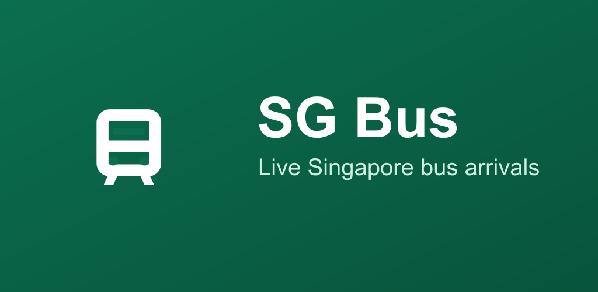
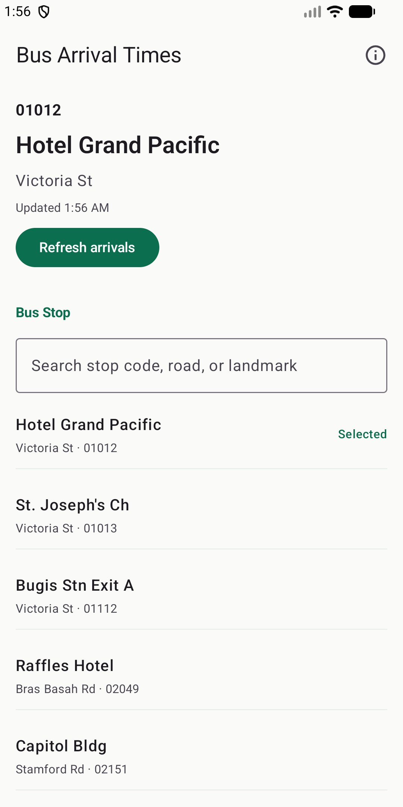
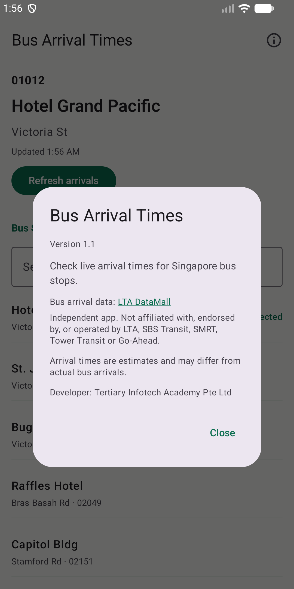

<div align="center">

# 🚌 Bus Arrival Times (Android)

[](https://www.android.com)
[](https://developer.android.com)
[](https://kotlinlang.org)
[](https://developer.android.com/jetpack/compose)
[](https://play.google.com/store/apps/details?id=com.tertiaryinfotech.sgbusapp)

**Live arrival times for Singapore bus stops, with seat availability.**

**[Google Play listing →](https://play.google.com/store/apps/details?id=com.tertiaryinfotech.sgbusapp)** · package `com.tertiaryinfotech.sgbusapp`



</div>

Native Android version of Bus Arrival Times (formerly *SG Bus*), mirroring the SwiftUI app at
[`alfredang/sgbusapp`](https://github.com/alfredang/sgbusapp). Version **1.1** (versionCode 2) is
submitted for production review on Google Play — see [CHANGELOG.md](CHANGELOG.md).

## Screenshots

| Stops | About & data source |
|:---:|:---:|
|  |  |

## Features

- Search common Singapore bus stops by stop code, road, or landmark.
- View live arrivals from LTA DataMall `v3/BusArrival`.
- Compare the next three arrivals for each service.
- Show bus load and vehicle labels: seats available, standing, limited standing; single, double, bendy.
- Refresh arrivals manually from the selected stop screen.
- Clear empty state when no buses are due (most services run about 5:30am – midnight).
- About screen with data-source credit and independence notice.

## Data source & independence

Bus arrival data comes from [LTA DataMall](https://datamall.lta.gov.sg), the Land Transport
Authority's open data service; the credit is shown under the arrivals list and in About.
Bus Arrival Times is an **independent app** — not affiliated with, endorsed by, or operated by LTA,
SBS Transit, SMRT, Tower Transit or Go-Ahead.

## Setup

1. Copy the example local configuration:

   ```bash
   cp local.properties.example local.properties
   ```

2. Set your LTA DataMall account key:

   ```properties
   ltaAccountKey=your_lta_datamall_account_key
   ```

3. Build:

   ```bash
   ./gradlew :app:assembleDebug     # debug APK
   ./gradlew :app:bundleRelease     # minified, signed release AAB (needs a local upload keystore)
   ```

The API key is read from `local.properties` into `BuildConfig.LTA_ACCOUNT_KEY`; `local.properties`
and the upload keystore are gitignored and must never be committed. Store listing text is in
[`play-listing.txt`](play-listing.txt) and graphics in [`play-assets/`](play-assets/).

## Developed by

[Tertiary Infotech Academy Pte Ltd](https://www.tertiaryinfotech.com/)
